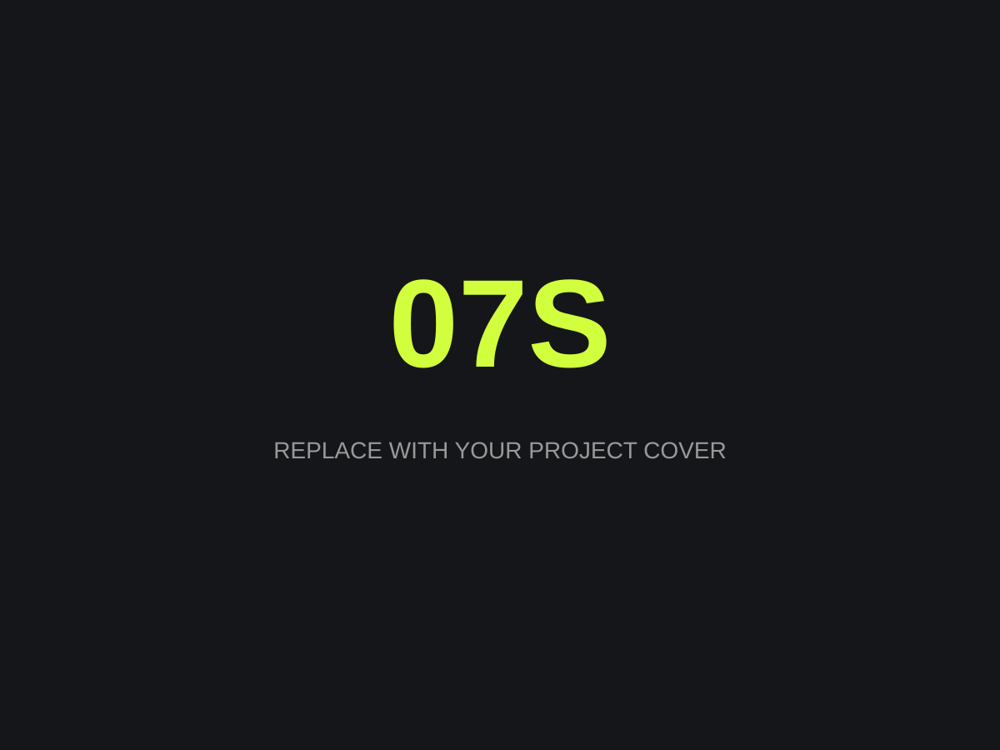

<!-- 中文编辑指南：这类注释不会显示在网页中。
1. 新增作品：复制整个 templates/work 文件夹到 works/，并给文件夹取英文名称。
2. 修改 project.json：填写作品名称、分类、年份、简介、封面等资料。
3. 修改本文件：用英文替换下面的标题、段落、列表和图片说明。
4. 图片和视频放在本作品的 media/ 文件夹，下面填写对应文件名。
5. 不需要的段落直接删除；标题前的 ##、图片的  等符号要保留。
6. 保存并同步 GitHub 后，系统会自动生成网页。
-->

<!-- 修改下面的英文标题；## 表示二级标题。 -->
## Project concept

<!-- 修改下面这段为作品背景、创作概念、观众体验；**文字** 表示加粗。 -->
Describe the background, **creative concept** and audience experience.

<!-- 段落之间空一行。下面可填写创作过程、技术方案或展览细节。 -->

## Process & details

Describe the creative process, technical approach or exhibition details.

<!-- 每行以 - 开头表示列表，按需增删。 -->
- Research and experimentation
- Design and production
- Installation and audience experience

<!-- 插入图片：把 media/cover.svg 改成你的图片路径，例如 media/install-01.jpg。
方括号里的英文是图片描述，供无障碍阅读及图片无法加载时使用。
复制下面整行即可继续加图片；不需要正文图片时可删除。
-->

<!-- 修改下面的英文图片说明；两侧 * 表示斜体，不需要可删除整行。 -->
*Add an image caption.*

<!-- 可选视频：先把 film.mp4 放入 media/，再去掉包住整个示例的注释符号。
同步修改视频文件名和 poster 封面路径；不需要视频就保留注释或删除示例。
## Film

<video controls playsinline preload="metadata" poster="media/cover.svg">
  <source src="media/film.mp4" type="video/mp4">
</video>
-->
